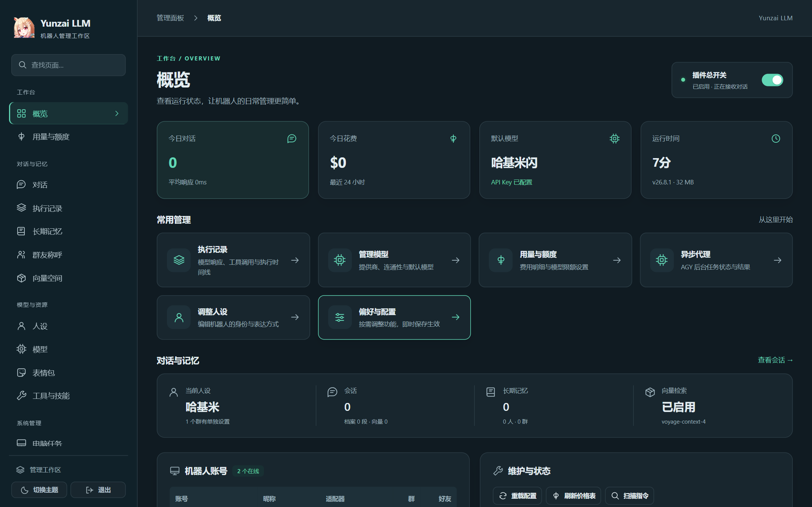

# Yunzai-LLM-Plugin

> 🤖 **TRSS-Yunzai / Miao-Yunzai 的现代化大模型对话插件**  
> 默认只在被 **@** 或引用时说话（可按群开启主动发言），轻扰动设计，绝不抢占群内任何已有插件的指令。

[](LICENSE)
[](https://nodejs.org/)
[](http://llmplugin.rabimimi.com/)

---

## 🎨 Web 管理面板一览

插件启动即提供现代化的 Web 可视化管理工作区（默认监听 `0.0.0.0:6190`，支持本地与远程局域网/服务器 IP 直接访问），零基础也能轻松上手：



---

## ✨ 核心亮点

- 🌐 **全主流协议大模型支持**：
  - OpenAI 兼容接口（DeepSeek、通义千问、Kimi、智谱 GLM、SiliconFlow、OpenRouter、Ollama…）
  - OpenAI Responses API（OpenAI、DeepSeek）
  - Anthropic Messages API（Claude，内置**显式提示词缓存断点**，输入费用立省高达 90%）
  - Google Gemini Interactions API（原生直读高清图片、音频、长视频与 PDF）
- 💳 **多维额度控制与平滑容灾**：
  - 每个模型独立支持「5 小时滚动额度」与「7 天滚动额度」（美元计价），细分单人、单群与全局控制。
  - 自动同步 LiteLLM / OpenRouter 权威实时价格表，真实统计缓存与思考 Token。
  - 主力模型额度用尽时**自动无感切换至备用模型**。
- 🧠 **分层记忆与 3D 向量空间**：
  - 上下文滑动窗口 + 滚动片段摘要 + 每日概要（保留 365 天）+ 长期事实自省。
  - Voyage AI 等向量模型与关键词混合检索，Web 面板支持 3D PCA 降维点云交互探索。
- 🎚️ **自动思考强度与主动发言**：
  - 判断模型按消息类别自动选择思考强度；可按群开启主动发言，在合适的时机自然接话。
- ⏰ **定时任务**：
  - 「10分钟后提醒我」「每个工作日9点提醒打卡」「半小时后再看看网页更新没有」：到点后机器人回到原对话执行并回复，重启后仍然有效；Web 面板可查看、编辑、取消。
- 🎭 **情境表情包与视觉打标**：
  - 管理员发送或引用图片即可收录，视觉模型自动解析命名并打标；聊天时按情境概率以 QQ 真实表情发送。
- ⚡ **自然语言转机器人指令**：
  - 自动扫描当前已启用的业务插件，用户用口语提问时自动识别并转为对应指令，以提问者原身份安全重分发。

---

## ⚠️ 平台兼容性说明（重要）

- ✅ **基础全功能跨平台支持 (Windows / Linux 通用)**：
  普通大模型对话、Web 管理面板、多提供商切换、额度控制、表情包、多层记忆与向量检索在 **Windows 和 Linux 系统上均可稳定运行**。
- ⚠️ **高级系统级工具目前仅支持 Windows 宿主机**：
  以下高级扩展环境深度依赖 Windows 宿主机与 WSL2 专用 Linux 虚拟子系统的安全沙盒联动，**当前阶段仅支持在 Windows 10/11 操作系统上部署**：
  - **安全代码沙盒 (`run_code`)**：在 WSL2 + bubblewrap 隔离环境中安全运行 Python / Node / Bash（阻断 Windows 磁盘与局域网访问）。
  - **持久桌面电脑使用 (`computer_task`)**：大模型自主操作独立的虚拟桌面，实现自动鼠标点击、键盘输入与任务回报。
  - **Google Lens 视觉反向搜图 (`google_lens`)**：在持久桌面的浏览器中以图搜图。
  - **RustDesk 远程控制与 AGY 宿主机全能代理**。

详细支持矩阵请参见 [平台支持说明](docs/content/tools/platform-support.md)。

---

## 🚀 用户安装指南

### 1. 环境准备
确保您的运行环境中 **Node.js 版本 ≥ 22.13**（插件依赖 Node 官方内置的原生 SQLite 模块 `node:sqlite`）。

### 2. 克隆插件与安装依赖
在您的 Yunzai-Bot 根目录下运行：

```bash
cd plugins
git clone https://github.com/KCFindstr/Yunzai-LLM-Plugin.git Yunzai-LLM-Plugin
cd ..
pnpm install
```

> 💡 **无需编译**：仓库内已自带构建完毕的 `dist/` 文件，安装依赖后直接启动机器人即可！

### 3. 启动并接入第一个模型
重启你的 Yunzai-Bot，任选以下一种方式完成初始化配置：

- **方法 A：使用 Web 管理面板（最推荐）**  
  在浏览器打开 **`http://<服务器IP或127.0.0.1>:6190`**（默认监听 `0.0.0.0` 支持远程访问；初次启动密码打印于控制台，并保存在 `data/Yunzai-LLM-Plugin/web-auth.json`），首次打开会进入设置向导，按步骤填入 API Key 并选择默认模型。
- **方法 B：私聊机器人快速配置**  
  管理员在私聊中直接发送：
  ```text
  #llm设置密钥 deepseek sk-xxxxxxxxxxxxxxxx
  #llm切换模型 deepseek
  #llm测试模型
  ```
- **方法 C：命令行交互式配置**  
  在终端中进入插件目录运行：
  ```bash
  cd plugins/Yunzai-LLM-Plugin
  npm run config
  ```

---

## 📋 常用指令

| 指令 | 说明 | 权限 |
| :--- | :--- | :--- |
| `@机器人 <内容>` / 引用消息回复 | 发起大模型对话，可携带图片或文件 | 所有人 |
| `#llm帮助` | 查看帮助菜单（管理员会额外看到全部管理指令） | 所有人 |
| `#llm状态` / `#llm额度` | 查询插件状态、自身用量与剩余额度 | 所有人 |
| `#llm清除记忆` | 清空当前对话上下文与短期会话历史 | 所有人 |
| `#llm模型列表` / `#llm切换模型 <ID>` | 查看所有可用模型 / 切换全局默认模型 | 管理员 |
| `#llm额度设置 <模型> user 5h=1 week=3` | 设置每人每 5 小时限额 $1、每周 $3 | 管理员 |
| `#llm添加表情`（附图或引用图片） | 添加表情包，由视觉大模型自动识别与打标 | 管理员 |
| `#llm设置 <配置路径> <值>` | 动态热修改任意配置项 | 管理员 |

---

## 📖 完整文档中心

关于本插件的深度配置、Docusaurus 文档站点源码、各提供商高级缓存机制与 Windows 高级工具配置指南，请进入项目专属文档目录：

👉 **[查看完整文档](docs/content/index.md)** (位于 [`docs/`](docs/) 目录)

在 `docs/` 目录下运行 `npm run start` 即可在本地启动完整的 Docusaurus 文档预览站点。

---

## ⚖️ 免责声明与开源协议

1. 本项目仅供个人学习、技术研究与学术交流使用，严禁用于任何非法行为或商业牟利。
2. 本插件接入的各第三方大模型生成内容不代表本项目立场。
3. 本项目遵循 [GNU General Public License v3.0](LICENSE) 开源协议。
